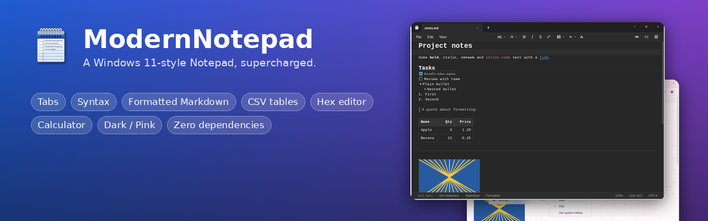
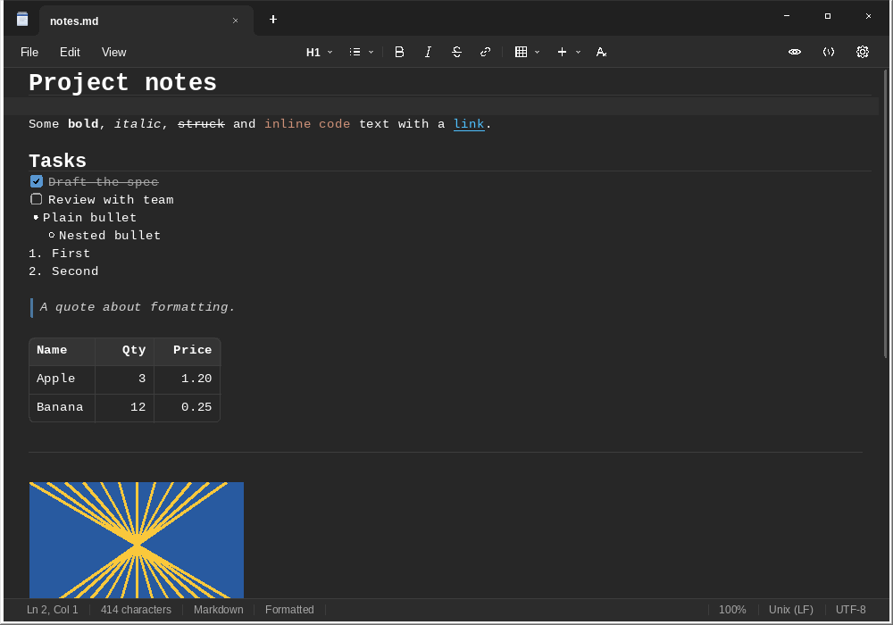
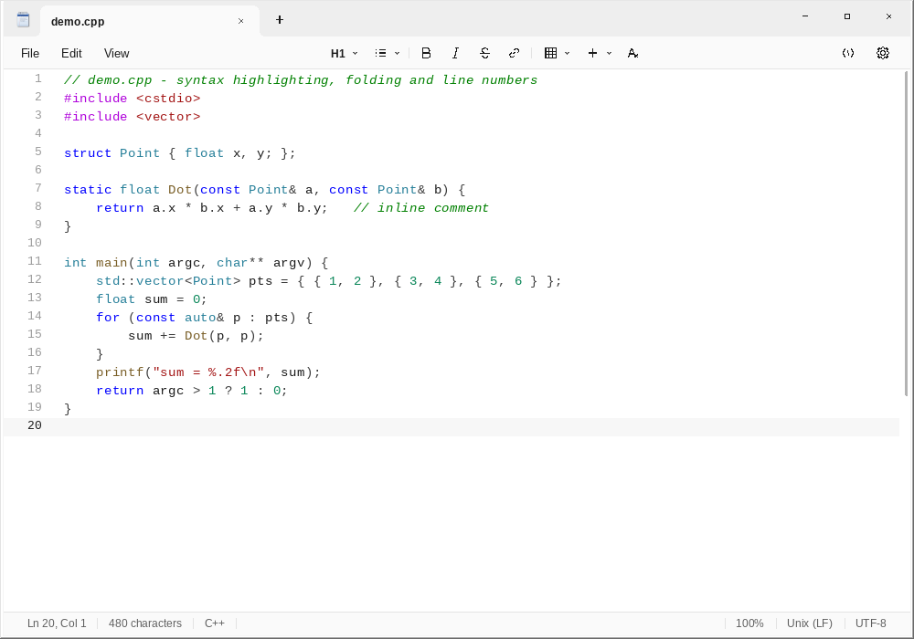
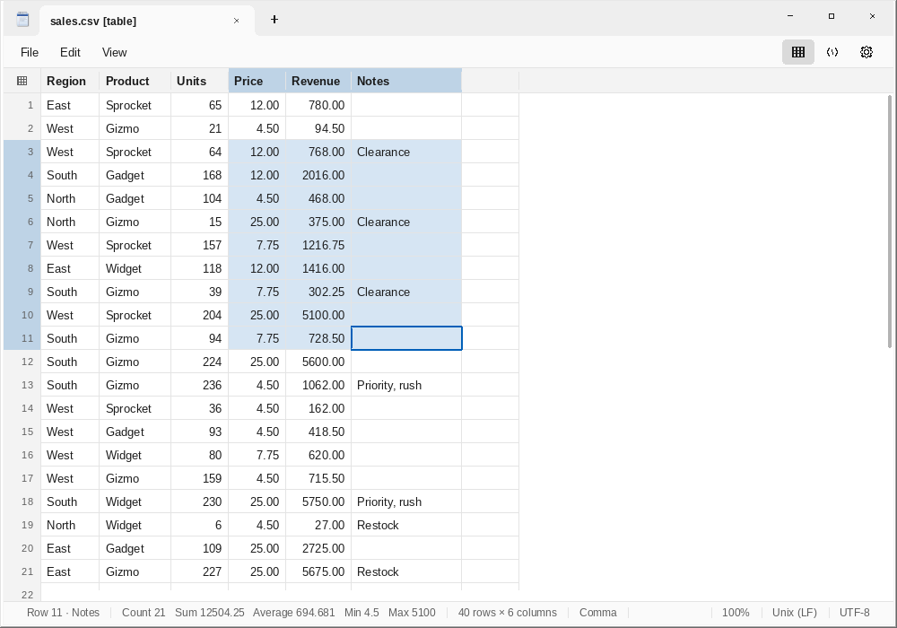
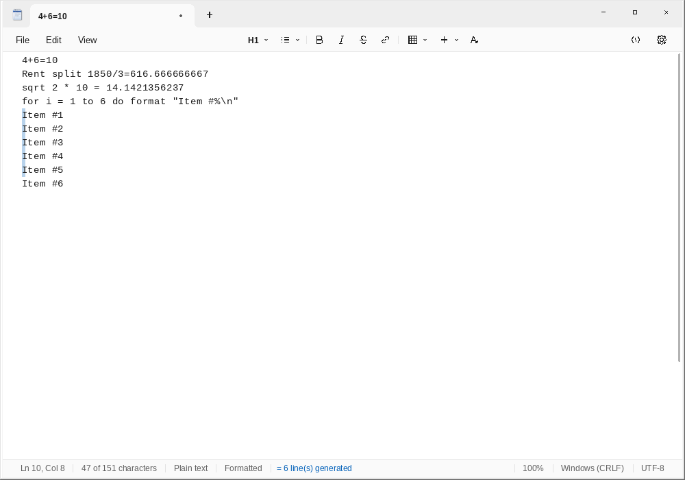
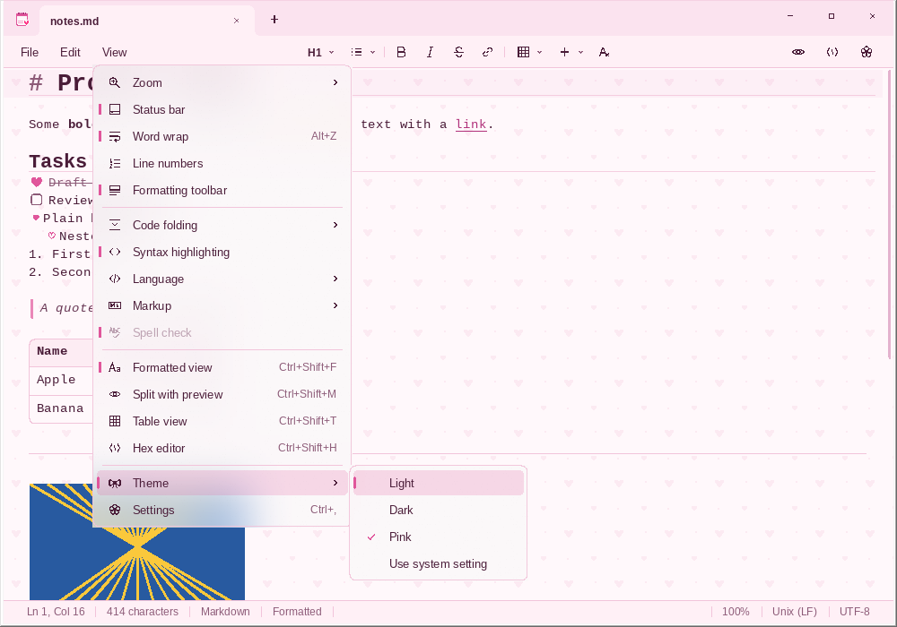
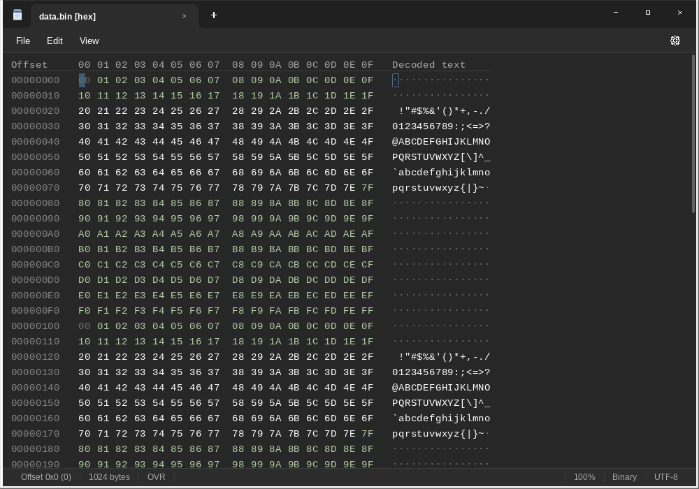
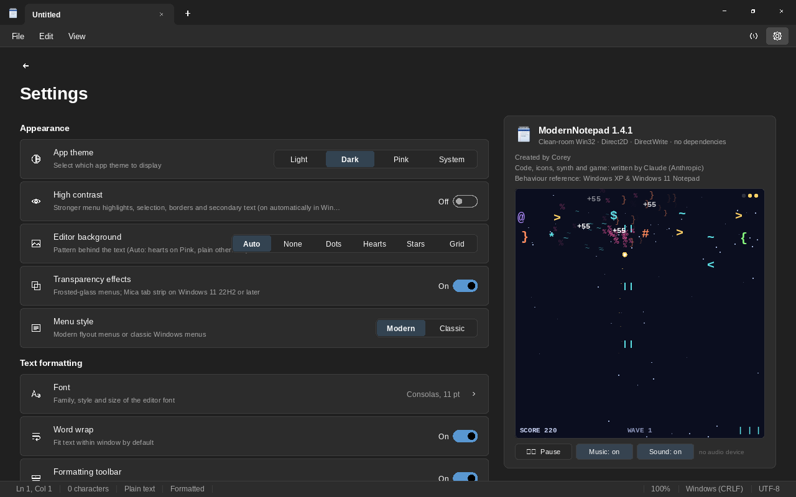

<p align="center">
  
</p>

<p align="center">
  <a href="https://github.com/coreynguyen/ModernNotePad/actions/workflows/build.yml"></a>
  <a href="https://github.com/coreynguyen/ModernNotePad/releases/latest"></a>
  <a href="https://github.com/coreynguyen/ModernNotePad/releases"></a>
  
  
  
  
  
  <a href="LICENSE"></a>
</p>

**ModernNotepad** is a single-executable text editor for Windows 10/11. It has the look and feel of the
Windows 11 Notepad and adds the features people keep installing a second editor for. It is written in plain C++20 on Win32 +
Direct2D + DirectWrite, with **no third-party dependencies, no runtime and no installer**. Everything it links ships with Windows.

<p align="center">
  
  
</p>

## Features

| | |
|---|---|
| **Tabs & sessions** | Tabs in the title bar, drag to reorder. Unsaved work survives closing and crashes (atomic backups every 5 s). |
| **Formatted Markdown** | Edit Markdown *as rendered text*, the way Win11 Notepad and Obsidian do: headings, lists, checkboxes, links, images, and **tables you type into cell by cell**. The source stays plain `.md`. |
| **Code** | Syntax highlighting for 20+ languages, code folding, line numbers, comment toggling, move/duplicate lines. |
| **Find & replace** | Match case, whole word, and regex (own linear-time engine: no catastrophic backtracking, no stack overflows) with `$1` replacements. |
| **CSV / TSV tables** | `.csv` files open as a spreadsheet-style grid: sort, insert/delete rows and columns, multi-cell copy/paste with Excel, Sum/Avg/Min/Max of the selection. |
| **Evaluate** | Ctrl+Shift+Enter on `4+6` gives `4+6=10`. Works on whole scripts too: `for i = 1 to 10 do format "#%\n"` generates text. Powered by a sandboxed MAXScript interpreter. |
| **Hex editor** | Any file, insert/overwrite, nibble editing, own undo. |
| **Encodings** | UTF-8 (± BOM), UTF-16 LE/BE, ANSI (warns before losing characters). CRLF / LF / CR detection and conversion. |
| **Looks** | Light, Dark, **Pink** (with its own icons and heart patterns), High contrast. Mica, frosted menus, themed dialogs, per-monitor DPI and text scaling. |
| **Accessible** | UI Automation text provider, so Narrator / NVDA / JAWS can read by character, word and line and follow the caret. |
| **Safe by default** | Verified atomic saves, detection of files changed by another program, and an optional AI pane that is **off by default** and never sends anything unless enabled. |

<p align="center">
  
  
</p>
<p align="center">
  
  
</p>

<details>
<summary><b>Easter egg:</b> Settings has a tiny shoot-'em-up with a synthesized chiptune</summary>
<p align="center"></p>
</details>

## Download

Grab `ModernNotepad.exe` from the [latest release](https://github.com/coreynguyen/ModernNotePad/releases/latest) and run it.
It needs no install and no runtime. Settings live in `HKCU\Software\ModernNotepad`, and session backups in
`%LOCALAPPDATA%\ModernNotepad`.

## Build

* **Visual Studio 2022/2026:** open `ModernNotepad.sln`, select `Release | x64` (ARM64 is configured too) and build. Output: `bin\x64\Release\ModernNotepad.exe`.
  The project uses toolset v145; on VS 2022, retarget to v143 or pass `/p:PlatformToolset=v143`.
* **Command line:** `msbuild ModernNotepad.sln /p:Configuration=Release /p:Platform=x64`
* **Core tests (any OS):** `g++ -std=c++17 -O2 -Isrc tests/core_tests.cpp src/core/*.cpp -o core_tests && ./core_tests`

## Keyboard (highlights)

| Keys | Action |
|---|---|
| Ctrl+N / Ctrl+W | New / close tab |
| Ctrl+F, Ctrl+H, F3 | Find, replace, next |
| Ctrl+Shift+F | Formatted view ↔ Markdown source |
| Ctrl+Shift+Enter | Evaluate expression / script |
| Ctrl+Shift+T | Table view (CSV) |
| Ctrl+Shift+H | Hex editor |
| Ctrl+K | Insert link |
| Ctrl+D, Alt+↑/↓, Ctrl+/ | Duplicate, move, toggle comment |
| Ctrl + / − / 0 | Zoom |

The full list is in [docs/TECHNICAL.md](docs/TECHNICAL.md).

## Project layout

```
src/core/      portable C++17: text buffer + undo, encodings, syntax, folding, search, regex,
               markdown / BBCode / HTML, CSV, live-format analysis (builds and tests on Linux too)
src/app/       Win32 + Direct2D UI: editor, tabs, menus, dialogs, table / hex / preview views,
               UI Automation, evaluate, credits game
third_party/   mxs - MAXScript interpreter (from the same author's MAX2Modern project)
tests/         core_tests.cpp (234 checks), bench_large.cpp
docs/          TECHNICAL.md (design notes), images/
```

## Documentation

* [Technical notes](docs/TECHNICAL.md): architecture, verification, known limits
* [Changelog](CHANGELOG.md)
* [Contributing](CONTRIBUTING.md)

## License

Released into the public domain under [the Unlicense](LICENSE). Use it, fork it, ship it, sell it.
No attribution is required, though it's always appreciated.

*ModernNotepad is an independent project and is not affiliated with or endorsed by Microsoft.
Windows and Notepad are trademarks of Microsoft Corporation.*
